# Dressing Room

**Demo**

A digital closet and AI outfit rater for iPhone and Android: photograph your clothes once, then get a daily outfit, a score for any outfit you build, and ideas for what's missing, in English or Spanish. Built with Expo and Supabase.

<table>
  <tr>
    <td>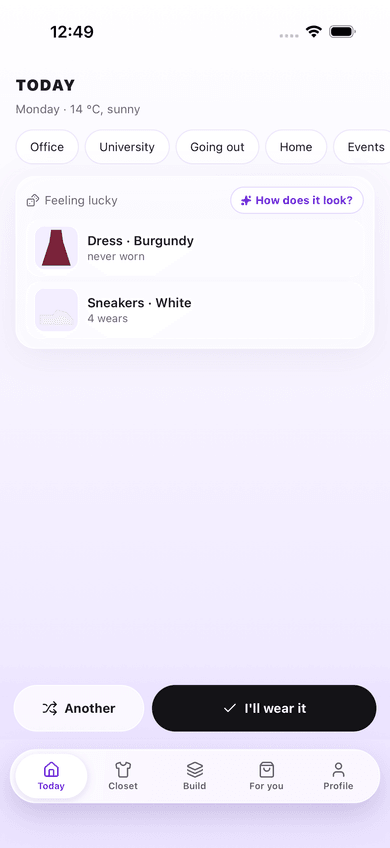</td>
    <td>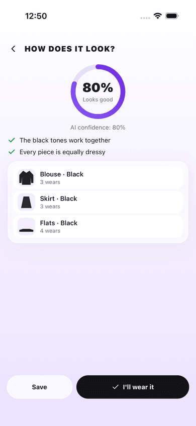</td>
    <td>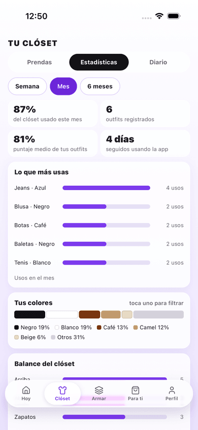</td>
    <td>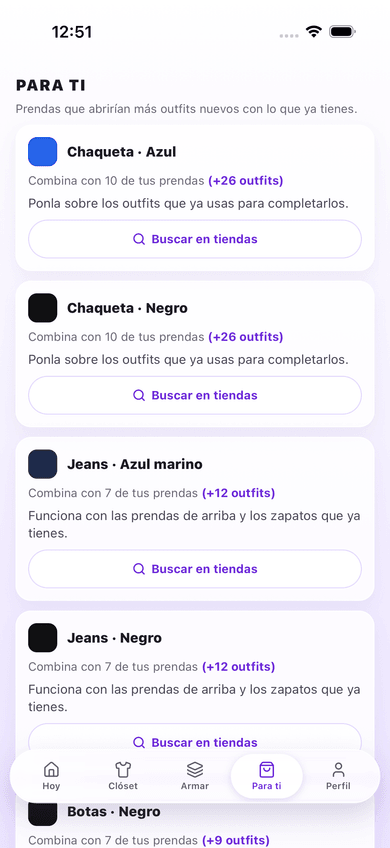</td>
  </tr>
</table>

<details>
<summary>All screenshots, English and Spanish (iOS simulator, fictional closet)</summary>

| Screen | English | Spanish |
| --- | --- | --- |
| Today |  | 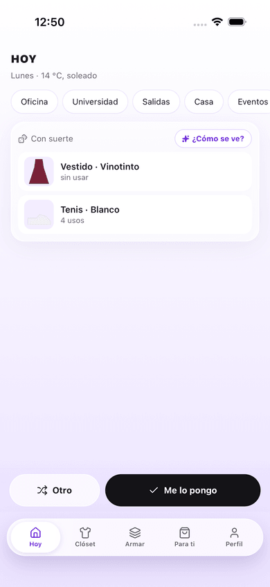 |
| Closet | 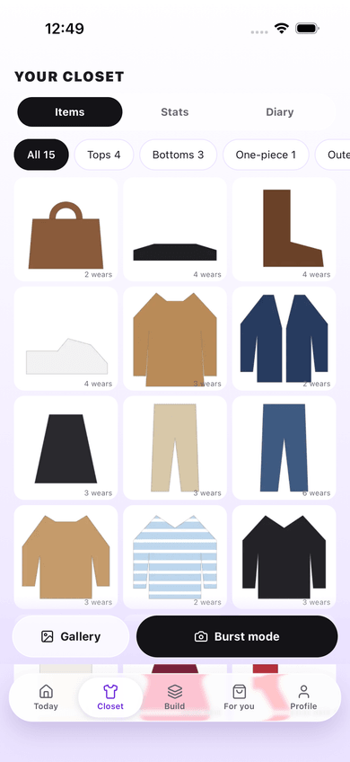 | 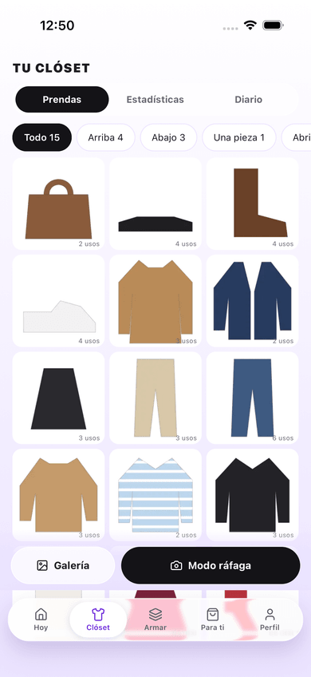 |
| Stats | 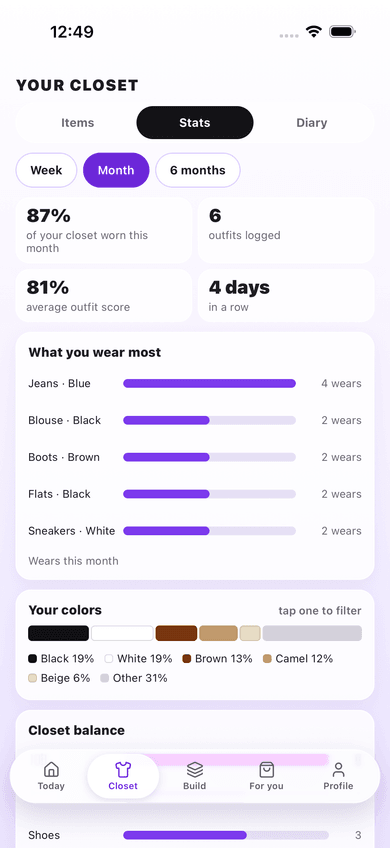 |  |
| Diary | 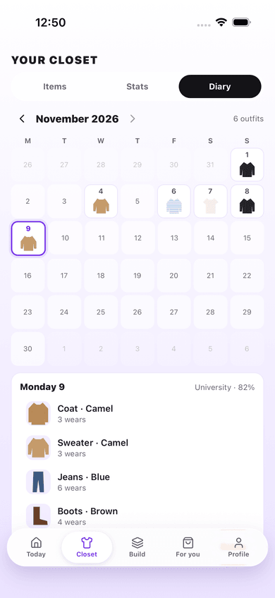 | 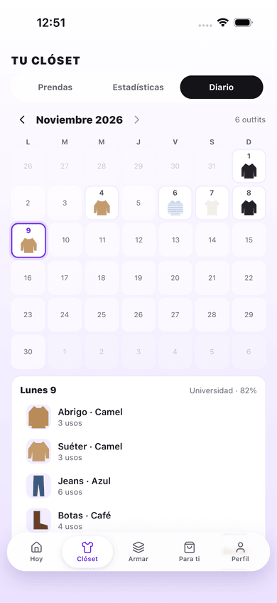 |
| Build | 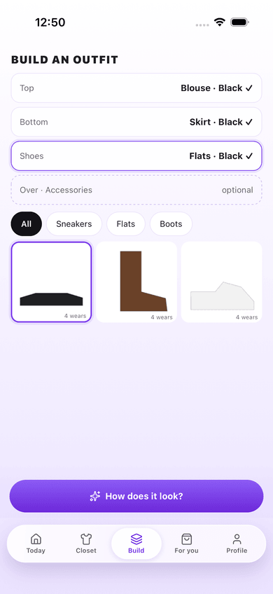 | 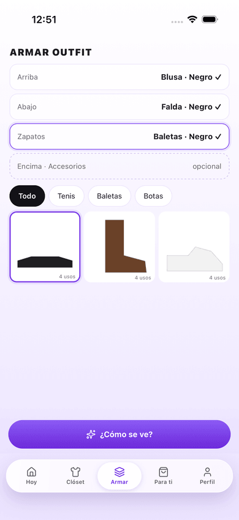 |
| Rating |  | 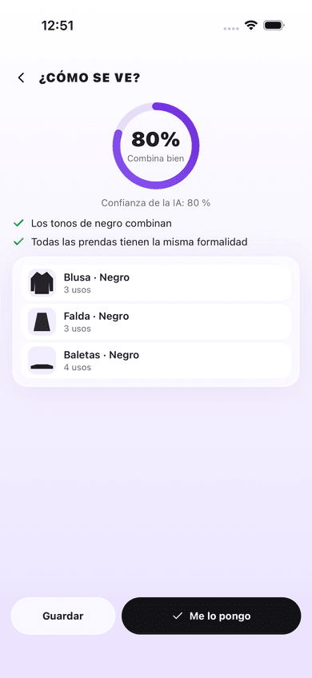 |
| For you | 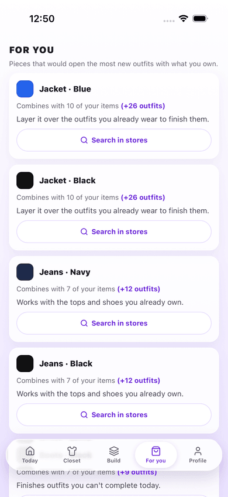 |  |
| Profile | 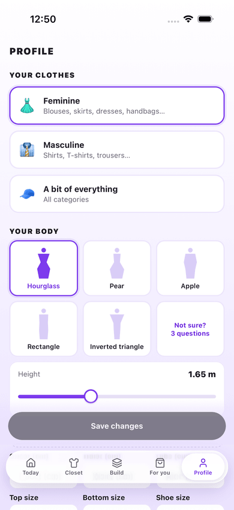 | 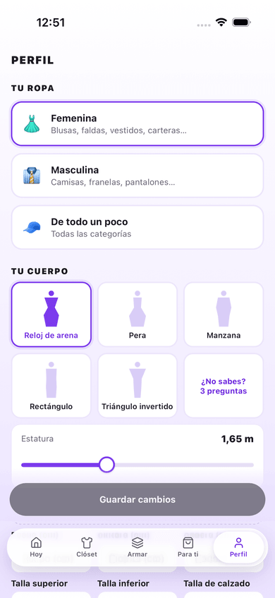 |

The screenshots come from the local stack with the mock Jev and Open-Meteo (every outfit scores 80, 14 °C and sunny) and two fictional `@example.com` accounts, one per language, whose closet is drawn shapes, not photos.

</details>

## What works now

- Expo Router app (SDK 58) with strict TypeScript, lint, and tests.
- Five tabs (Today, Closet, Build, For you, Profile) behind a custom floating glass tab bar: liquid glass on iOS 26+, a blurred frosted capsule on older iOS, and a frosted fill on Android.
- English and Spanish UI, picked from the device language (anything else falls back to English), with an in-app override.
- Accounts: email/password sign-up and sign-in, Sign in with Google and Sign in with Apple (iOS), and a 6-digit password-reset code sent by email.
- A three-step onboarding flow (clothing type, body measurements, style and occasions) with a skip action on all but the first step, backed by a Postgres profile row protected by row-level security.
- An editable Profile tab (clothing, body, style sections) sharing its form with onboarding, plus the language override, sign-out and a Privacy section: body data is visible only to you and the AI only gets ranges; "Export my data" shares a JSON file of your profile, garments, outfits, wears and 7-day photo links; "Delete account" (two confirms) removes your photos, revokes Sign in with Apple (once the owner sets the Apple key) and deletes your account and every row, then clears this phone's copy of your data (its saved data, data exports and cached photos) and signs you out. If the answer is lost, uploads stay paused and the app checks at the next launch whether the account is gone; it never deletes without your tap.
- A Closet tab with a virtualized three-column grid (FlashList + expo-image), a "Your 10 favorites" goal card and slot filter chips.
- Stats (Closet tab): week, month or 6 months of how much of your closet you wear, outfits logged, the average outfit score and your streak; what you wear most, your colors (tap one to filter the closet), the closet balance with how many more outfits one piece would open, and what you haven't worn in 6 months, with "Wear it" (in tomorrow's suggestions) and "Donate".
- Diary (Closet tab): a month calendar with each worn day's outfit; tap a day for its pieces, occasion and score, or delete a wear.
- Adding clothes: a burst camera (one garment per shot, no forms) and a gallery multi-select. Each photo goes through a queue kept on the phone: on-device background removal (iOS Vision, Android ML Kit), a resized WebP and thumbnail, then an upload to private storage. The queue resumes after the app is closed or offline, without losing or duplicating a photo.
- AI attributes: inserting a garment triggers an Edge Function that asks Claude for its category, colors, pattern, material, formality, seasons, warmth, fit and occasions (100 reads per user per day). Locally a mock Claude answers; nothing calls the real API until the owner sets the hosted keys.
- A review queue ("1 of 3") that asks only what the AI doubted, as quick choices, and shows the rest confirmed.
- Garment detail: edit any attribute, set it as available, in the laundry or lent out, replace its photo, or delete it (its photos are removed from storage too).
- Today: the day's weather for your city, an optional occasion, and a "feeling lucky" outfit from your closet (ranked by the Jev rating model, skipping what you wore this week) with "Another" and "I'll wear it", which logs the wear and bumps each piece's wear count. A closet missing a top, bottom or shoes is told what to add instead.
- Build: pick an outfit piece by piece (top and bottom or a one-piece, shoes, and optional outerwear and an accessory) from the garments that are available, filtered by category, then ask "How does it look?".
- Rating: a 0–100 score with a label, the AI's confidence, short reasons, and for a weak outfit a one-tap swap of its weakest piece; save the outfit or log it as worn. Jev rates it, with Claude as a fallback marked "estimated". Locally mock Jev and Open-Meteo services answer; nothing calls the real APIs until the owner sets the hosted keys.
- For you: 3–5 staples your closet is missing, ranked by how many new outfits each opens with what you own and how well it suits your body and style, each with a short line and a "Search in stores" button that opens a web search in your language. The last ideas stay readable offline. A low rating with no swap links here ("Missing something?").
- Accessibility: tab labels, charts and the score ring read with meaningful labels in VoiceOver and TalkBack; content text follows the system text size with no cap, while fixed chrome, such as the tab bar, anchored buttons, the score ring and calendar cells, stops between 1.2× and 1.6×; and with Reduce Motion on, the bars and the score ring show their final state without animating.
- Jev calibration: `pnpm calibrate export|collect|eval` turns hand-labeled saved outfits into an agreement report (Spearman's ρ, band accuracy, a confusion matrix) with suggested weights, bands and confidence aggregate. Real labels stay in gitignored files.
- Nightly hosted backup: `pnpm backup` dumps the database and downloads every photo with a sha256 manifest to the owner's Mac, keeping the newest 14, with a tested restore.
- Release config: `eas.json` profiles for development, internal preview and store builds, and EAS Submit to TestFlight and the Play internal track.
- Fixture mode for performance testing: with `EXPO_PUBLIC_PERF_FIXTURES_URL` set, the Closet grid shows 500 generated thumbnails served from your computer, a disabled upload CTA, and a frame-stats HUD (frames, dropped frames, p95 and median frame time, inferred refresh rate). Tap the HUD to reset it; long-press it to also clear the image caches for a cold pass.

## Architecture


The app talks only to one Supabase project, with the user's session: Auth, Postgres with row-level security on every table, a private photo bucket, and seven Edge Functions. Background removal, resizing and a resumable upload queue run on the phone, and so do Stats and Diary. Only the Edge Functions call the outside services: Claude labels each garment photo, TypeSafe's Jev rates outfits from bucketed, enum-only data (never photos or measurements), and Open-Meteo gives the weather. Code owns the workflow; per-user daily quotas and caches come before any paid call, and each model failure has a fallback.

How it works, how it fails, and why it's built this way: [`docs/architecture.md`](docs/architecture.md), with the upload pipeline, the rating sequence and the data model. Open [`docs/diagrams/system-context.html`](docs/diagrams/system-context.html) from a local clone for the interactive diagram.

| Document | Covers |
| --- | --- |
| [`docs/architecture.md`](docs/architecture.md) | Components, request lifecycles, data model, failures, security, scaling and costs, design decisions |
| [`docs/ai.md`](docs/ai.md) | Every prompt, schema, Jev question and weight, the calibration workflow, quotas and costs |
| [`docs/database.md`](docs/database.md) | Tables, enums, RLS and grants, storage rules, account deletion and export, hosted backups |
| [`docs/red-team.md`](docs/red-team.md) | Prompt injection, the output sanitizers, quota abuse and cross-user access, each with the test that pins it |
| [`docs/testing.md`](docs/testing.md) | Every test suite, the end-to-end flows and what CI runs |
| [`docs/performance-gate.md`](docs/performance-gate.md) | The on-device scroll-performance go/no-go protocol (status: pending) |
| [`docs/privacy-policy.md`](docs/privacy-policy.md) | What the app collects and who processes it ([español](docs/privacy-policy.es.md)) |

## Quick start

You need Node 24, pnpm 11, Xcode with an iOS simulator, and OrbStack or Docker for the local Supabase stack.

```bash
pnpm install
pnpm db:start     # Postgres, Auth, Storage, Studio, Mailpit and the Edge Runtime in Docker (first run pulls images)
pnpm db:reset     # the migrations and the local seed
pnpm env:local    # writes .env.local with the app's Supabase URL and anon key
pnpm expo run:ios # builds the dev client and opens it in the simulator (keeps Metro running)
```

Local sign-up confirmations and password-reset codes are caught by Mailpit at
`http://127.0.0.1:54424` instead of being emailed. `pnpm db:stop` stops the stack when you're done.

Nothing local calls a real AI or weather API. To see the AI features in the simulator, keep the mocks running in other terminals:

```bash
node integration/mockServices.ts --serve --level 0.8 --temp 14   # mock Jev and Open-Meteo: every outfit scores 80, 14 °C
node integration/mockAnthropic.ts --serve ok                      # mock Claude: every photo gets the `ok` fixture's attributes
```

Without them, a new garment goes to review with empty fields, a rating falls back and then fails, and the weather is unknown. See [`AGENTS.md`](./AGENTS.md)'s "Local backend" for the stack's ports, secrets and mocks, and its "Commands" for the full list.

Closet grid with performance fixtures (iOS simulator):

```bash
pnpm perf:generate   # once: writes 500 thumbnails to .perf-fixtures/
pnpm perf:serve      # serves them on port 8787 and prints the LAN URLs
EXPO_PUBLIC_PERF_FIXTURES_URL=http://127.0.0.1:8787 pnpm expo run:ios
```

On a physical iPhone, use the LAN URL `perf:serve` prints for the Wi-Fi the phone is on, and allow Local Network access when iOS asks.

## Tests

```bash
pnpm typecheck && pnpm lint && pnpm test   # strict TypeScript, ESLint, and the app, scripts and functions Jest projects
pnpm db:test                               # pgTAP: RLS, grants, constraints, triggers, quotas and the deletion cascade
pnpm test:int                              # integration against the local stack: auth, RLS across users, uploads, extraction, the outfit and account functions
pnpm e2e                                   # Maestro flows on the iOS simulator: sign-up to Stats, build → rate → swap, account deletion
```

`pnpm test` needs no Docker. `db:test` and `test:int` need the local stack (`pnpm db:start && pnpm db:reset && pnpm env:local`). `pnpm e2e` also needs the dev build on a booted simulator, Metro, Maestro and Java 17 (`brew install maestro openjdk@17`); it starts the mocks and signs up a fresh `@example.com` user itself. AI calls are tested against recorded-shape fixtures and mocks, never the real APIs.

CI runs the quality gate (supply-chain settings, typecheck, lint, unit tests, expo-doctor), a security job (gitleaks, `pnpm audit`), workflow linting (actionlint, zizmor), and a database job (pgTAP, a generated-types drift check and the integration tests). A separate CodeQL workflow (pull requests, `main` and weekly) analyzes the code once the repo is public; it skips itself while the repo is private. [`docs/testing.md`](docs/testing.md) lists every suite.

## Owner setup

Everything above runs offline. These steps need the owner's accounts, once, at the end:

- Rebuild the dev client (`pnpm expo run:ios` / `pnpm expo run:android`): `garment-cutout` is a local native module and `expo-sharing` (data export) has native code, so an older dev client fails to load the Profile tab.
- Set the hosted secrets: the extraction webhook's Vault secrets and `EXTRACT_WEBHOOK_SECRET`, `ANTHROPIC_API_KEY`, `TYPESAFE_API_KEY`, and the `APPLE_*` ones (without them, account deletion can't revoke Sign in with Apple). Then set spend caps or alerts with Anthropic and TypeSafe.
- Configure Sign in with Apple and Google, and the email sender for confirmations and reset codes.
- Label about 50 saved outfits and run `pnpm calibrate` to tune Jev's weights and bands.
- Publish the [privacy policy](docs/privacy-policy.md) (fill in its `<owner email>`) on GitHub Pages.
- Schedule the nightly `pnpm backup` with launchd and restore it once.
- Run `eas init`, then `eas build` and `eas submit` against [`eas.json`](./eas.json)'s profiles, to put a build on TestFlight and the Play internal track.

The full checklist is [`AGENTS.md`](./AGENTS.md)'s "Owner session".

## Costs

Sized for a family of about 4 on Supabase's free tier. From [`docs/ai.md`](docs/ai.md)'s "Quota and cost":

| Item | Cost |
| --- | --- |
| Garment extraction (Claude Haiku 5.5) | about $0.0003 per garment; about $0.18 for a first load of 600 garments |
| Ratings and lucky lists (Jev) | about $0.65 a month for 4 users in typical use; about $6 at worst, with every daily quota used up |
| For you | at most one cache miss per user a day, about $0.0005 each: at most about $0.06 a month for 4 users |
| Weather (Open-Meteo) | free, no key |
| Supabase | free tier |

Per-user daily quotas (100 extractions, 50 ratings, 10 lucky lists, 1 For you) bound the spend; typical use fits the $1-a-month target, and the spend caps the owner sets with the providers hold it.

## License

[MIT](LICENSE)
